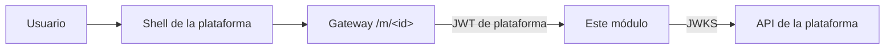

# Arquitectura técnica

- El gateway valida la sesión y el rol, y emite un JWT de 5 minutos para este módulo.
- El módulo verifica el JWT (firma ES256, `iss` y `aud = modulo:<id>`) y exige el rol de cada endpoint.
- Capas: `src/api` (HTTP y validación) → `src/dominio` (reglas puras). La persistencia (Postgres por
  esquema propio) llega en I4.
